# Architecture (`v4.0.0` — Consolidated Honeycomb 2-File Design)

This document describes the consolidated, object-oriented **Honeycomb architecture** of the CMI BFRB multimodal wearable time-series pipeline (`ALGO_VERSION = "4.0.0"`, `FEATURE_VERSION = "4.0.0"`).

All shared physics, Honeycomb preprocessing/feature cells, open-source feature backends, signal descriptors, augmentation adapters, search descriptors, and abstract parent classes live cleanly in **`src/base_utils.py`**. All PyTorch multi-branch neural architectures, windowed multi-branch extractors, tensor augmentors, and unified search children live in **`src/utils.py`** (renamed from `src/utils_v3.py`), inheriting directly from `base_utils` parent classes.

---

## 1. Honeycomb Parent–Child Class Hierarchy

```mermaid
classDiagram
    class HoneycombBase {
        +fit(X, y)
        +_parse_modes(modes_str)
        +_pipe_modes(value, allowed)
        +_structured(value)
    }

    class ProblematicSequenceFilter {
        <<preserved unchanged>>
    }
    class HandednessCanonicalizer
    class DenoisingFilterCell
    class SignalCleaner
    class MotionFilter
    class IMUExtractor
    class RotationExtractor
    class TOFExtractor
    class ThermoExtractor
    class STFTExtractor
    class CWTExtractor

    HoneycombBase <|-- ProblematicSequenceFilter
    HoneycombBase <|-- HandednessCanonicalizer
    HoneycombBase <|-- DenoisingFilterCell
    HoneycombBase <|-- SignalCleaner
    HoneycombBase <|-- MotionFilter
    HoneycombBase <|-- IMUExtractor
    HoneycombBase <|-- RotationExtractor
    HoneycombBase <|-- TOFExtractor
    HoneycombBase <|-- ThermoExtractor
    HoneycombBase <|-- STFTExtractor
    HoneycombBase <|-- CWTExtractor

    class WindowFeatureCell {
        <<abstract>>
        +compute(context, config)
        +transform(X)
        +as_spec()
        +register(registry)
    }
    HoneycombBase <|-- WindowFeatureCell
    WindowFeatureCell <|-- OrientationPostureCell
    WindowFeatureCell <|-- VibrationMultiaxialCell
    WindowFeatureCell <|-- ToFSpatialCell
    WindowFeatureCell <|-- ToFTemporalCell
    WindowFeatureCell <|-- ThermalDynamicsCell
    WindowFeatureCell <|-- CrossModalCell
    WindowFeatureCell <|-- EventsComplexityCell
    WindowFeatureCell <|-- MultiScaleCell
    WindowFeatureCell <|-- SequenceAggregationCell
    WindowFeatureCell <|-- SignalDescriptorCell
    WindowFeatureCell <|-- ExampleMeanCell

    class BaseSequenceExtractor {
        <<abstract>>
        +_new_manifest(rates)
        +_record_manifest_entry(...)
        +_compute_registry_features(...)
        +_apply_handedness_if_enabled(...)
        +manifest_to_json(path)
    }
    HoneycombBase <|-- BaseSequenceExtractor
    BaseSequenceExtractor <|-- SequenceExtractor : base_utils.py
    BaseSequenceExtractor <|-- MultiModalSequenceExtractor : utils.py

    class BaseAugmentor {
        <<abstract>>
        +_validate_probability(...)
        +_validate_non_negative(...)
        +_make_rng(seed)
    }
    HoneycombBase <|-- BaseAugmentor
    BaseAugmentor <|-- SensorAugmentor : base_utils.py
    BaseAugmentor <|-- TSAugmentor : utils.py

    class FeatureBackend {
        <<abstract>>
        +available()
        +get_feature_names(...)
        +compute_features(...)
    }
    FeatureBackend <|-- TSFELBackend
    FeatureBackend <|-- TSFreshBackend
    FeatureBackend <|-- Catch22Backend
    FeatureBackend <|-- TSFlexBackend
    FeatureBackend <|-- SeglearnBackend
    FeatureBackend <|-- SktimeBackend

    class BaseSequenceClassifier {
        <<abstract>>
        +_align_sequence_labels(...)
        +get_history_dict()
        +summarize_model()
    }
    BaseSequenceClassifier <|-- RandomForestSequenceClassifier : base_utils.py
    BaseSequenceClassifier <|-- MultiBranchTSAIClassifier : utils.py

    class BaseSearchCV {
        <<abstract>>
        +predict(X)
        +predict_proba(X)
        +score(X, y)
    }
    BaseSearchCV <|-- GASearchCV : base_utils.py
    GASearchCV <|-- MultiBranchGASearchCV : utils.py
    BaseSearchCV <|-- HierarchicalBayesSearchCV : utils.py
```



> **Preservation Guarantee:** `ProblematicSequenceFilter(HoneycombBase)` in `src/base_utils.py` is preserved byte-for-byte identical to `HEAD` (1,850 bytes).

---

## 2. Two-File Module Layout

| File | Role | Key Contents |
| --- | --- | --- |
| **`src/base_utils.py`** | **Honeycomb Parent & Core Layer** | 1. **Physics Kernel (`PhysicsKernel`)**: `ALGO_VERSION`, `FEATURE_VERSION`, `InvalidParams` → `InvalidExtractorParams`, `MetricEnvelope`, SciPy `Rotation` kinematics, per-row `body`/`world` gravity removal, configurable ToF sentinel cleaning (`tof_invalid_sentinels=(-1.0,)`), PSD & STFT `sqrt(coverage)` edge compensation.<br>2. **Registry & Provenance**: `FEATURE_REGISTRY`, `FeatureFamilySpec`, `FeatureManifest`, `FeatureManifestEntry`, `FeatureBackend`.<br>3. **Row-Level Honeycomb Cells**: `HoneycombBase`, `ProblematicSequenceFilter` (untouched), `HandednessCanonicalizer`, `DenoisingFilterCell`, `SignalCleaner`, `MotionFilter`, `IMUExtractor`, `RotationExtractor`, `TOFExtractor`, `ThermoExtractor`, `STFTExtractor`, `CWTExtractor`.<br>4. **Signal Descriptors**: `SignalDescriptorOptions` (`NoopOptions` alias), `IMUWindow`, `DESCRIPTOR_CATALOG` (canonical ↔ `noop_*`), Walch DoG, Baevsky SI, ACF periodicity, Hann PSD, quality, drift, `SignalDescriptorCell`.<br>5. **Window-Level Honeycomb Cells (`WindowFeatureCell`)**: `OrientationPostureCell`, `VibrationMultiaxialCell`, `ToFSpatialCell`, `ToFTemporalCell`, `ThermalDynamicsCell`, `CrossModalCell`, `EventsComplexityCell`, `MultiScaleCell`, `SequenceAggregationCell`, `ExampleMeanCell`.<br>6. **Real OSS Feature Backends (`FeatureBackend`)**: `TSFELBackend`, `TSFreshBackend`, `Catch22Backend`, `TSFlexBackend` (incl. MIT `sleep_analysis` actigraphy bank with D6 fix), `SeglearnBackend`, `SktimeBackend`.<br>7. **Abstract Parents & Tabular Implementations**: `BaseSequenceExtractor` → `SequenceExtractor`, `BaseSequenceClassifier` → `RandomForestSequenceClassifier`, `TsaugAdapter` + `BaseAugmentor` → `SensorAugmentor`, `ECat`/`EInt`/`EFloat` + `BaseSearchCV` → `GASearchCV`, `find_data_root`, `sample_balanced_split`, `build_quick_results_df`. |
| **`src/utils.py`** *(formerly `src/utils_v3.py`)* | **Multi-Branch PyTorch, Ensemble & Search Child Layer** | Imports all parents, cells, physics, descriptors, OSS backends, registry, adapters, and pretraining/SSL mixin (`PretrainingAndSSLMixin`) from `base_utils` & `pretraining_ssl_utils`, implementing:<br>• `MultiModalSequenceExtractor(BaseSequenceExtractor)` (multi-rate per-modality window tensors + `transform()` + `FEATURE_REGISTRY` dispatch + `feature_manifest_`)<br>• `TSAugmentor(BaseAugmentor)` (per-modality window tensor augmentation via `TsaugAdapter` with quaternion unit-norm protection)<br>• PyTorch modules (`_Conv1dBackbone`, `ToFSpatialEncoder`, `TemporalAttentionPool`, `ModalityBranch`, `MultiBranchTSAINet`, `FocalLoss`)<br>• `MultiBranchTSAIClassifier(PretrainingAndSSLMixin, BaseSequenceClassifier)` with `save_bundle` / `load_bundle`<br>• `MultiBranchEnsemble(BaseSequenceClassifier)` (`Ensemble` alias) scaling across 2–5+ models (`'hierarchical'`, `'soft_vote'`, `'stacking'`)<br>• `MultiBranchGASearchCV(BaseGASearchCV)` (`GASearchCV` / `HierarchicalGASearchCV`) & `HierarchicalBayesSearchCV(BaseSearchCV)`<br>• `ParamSpec`, `compile_unified_search_space`, `inactive_parameters_for_candidate`, `compute_permutation_importance`, `make_synthetic_cmi_df`. |
| **`src/pretraining_ssl_utils.py`** | **PyTorch Pretraining & Masked-Signal SSL Mixin** | Provides `PretrainingAndSSLMixin`, `MaskedSSLReconstructionHead`, `transfer_torch_backbone_weights`, `corrupt_raw_dataframe_spans` (quaternion-safe), `select_pretraining_sequences`, and `PretrainedMultiBranchTSAIClassifier`. |

---

## 3. Core Invariants

1. **Mask-Aware Computation:** Every `WindowFeatureCell` respects `context["masks"][branch]` so padded positions never affect feature outputs.
2. **True Sampling Rate Propagation:** Every branch carries its native/target sampling rate (`context["rates"]`); no cell hardcodes Hz.
3. **Leakage-Free Processing:** Baselines, intra-sequence window aggregations (`SequenceAggregationCell`), scalers, and `static_top_k` ANOVA F-score selection operate strictly within training folds / single sequences.
4. **Canonical Scientific Naming + Backward Compatibility:** All descriptors support canonical scientific names and legacy `noop_*` / `NoopOptions` aliases (see `docs/MIGRATION.md`).
5. **Provenance Manifest (`feature_manifest_`):** Both `SequenceExtractor` and `MultiModalSequenceExtractor` inherit `_new_manifest()` and `manifest_to_json()` from `BaseSequenceExtractor`.

---

## 4. Adding a New Honeycomb Feature Cell (Zero Core Edits)

Subclass `WindowFeatureCell` from `base_utils` and register it onto `FEATURE_REGISTRY` — neither `SequenceExtractor` nor `MultiModalSequenceExtractor` needs to be edited:

```python
import numpy as np
from base_utils import FEATURE_REGISTRY, WindowFeatureCell

class MyCustomCell(WindowFeatureCell):
    family_name = "my_custom_cell"
    config_key = "my_custom_cell_enabled"
    required_inputs = ("imu",)
    library_used = "numpy"
    units = "m/s^2"
    scope = "window"
    is_extension = True

    def compute(self, context, config):
        imu = np.asarray(context["branches"]["imu"], dtype=np.float64)
        mask = np.asarray(context["masks"]["imu"], dtype=bool)
        counts = np.maximum(mask.sum(axis=1), 1)
        vals = np.where(mask, imu[:, :, 0], 0.0).sum(axis=1) / counts
        return {"my_custom_cell__acc_x_mean": np.where(mask.any(axis=1), vals, 0.0)}

MyCustomCell.register(FEATURE_REGISTRY)
```

Enable it in either extractor via `extra_feature_families=("my_custom_cell",)` (`SequenceExtractor` in `base_utils.py` or `MultiModalSequenceExtractor` in `utils.py`). See `ExampleMeanCell` in `src/base_utils.py` for the built-in worked reference.
